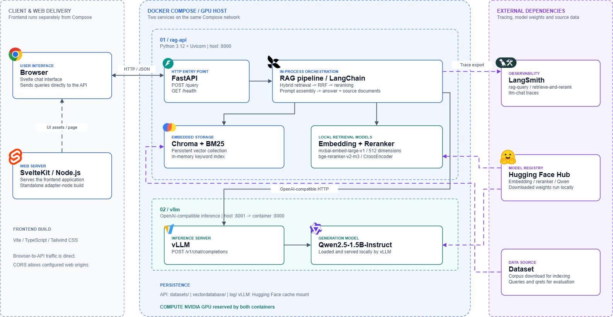

# RAG Web App

A local retrieval-augmented generation (RAG) web application with a **SvelteKit
frontend**, a **FastAPI backend**, and a **vLLM inference server**. The backend
indexes the BEIR `nfcorpus` dataset in Chroma, combines semantic and keyword
retrieval, reranks relevant passages, and calls a locally served model to
generate an answer with its supporting source documents.

The frontend runs separately from Docker Compose and communicates directly with
the FastAPI service over HTTP/JSON. Docker Compose runs the two GPU-enabled
backend services: `rag-api` and `vllm`.

## System Architecture



The vector database is created automatically on the first application start.
The build downloads `nfcorpus`, splits its documents into 2,048-character
chunks with 300-character overlap, and stores 512-dimensional normalized
embeddings in `vectordatabase/`.

## Requirements

- Python 3.12+
- [uv](https://docs.astral.sh/uv/)
- Node.js 22.17+ and npm
- Docker Desktop with Compose
- An NVIDIA GPU, effectively required by vLLM


## LLM server

Answer generation goes through the `LLMClient` protocol in `src/model.py`,
implemented against vLLM's OpenAI-compatible `/v1` API. Configure it with
environment variables:

| Variable | Default | Description |
| --- | --- | --- |
| `LLM_BASE_URL` | `http://localhost:8001` | vLLM server URL. |
| `LLM_TIMEOUT` | `120` | Request timeout in seconds. |
| `GENERATE_MODEL` | `Qwen/Qwen2.5-1.5B-Instruct` | Hugging Face repo id vLLM was launched with. |
| `LLM_API_KEY` | `EMPTY` | Only used if vLLM was started with `--api-key`. |

vLLM names models by the Hugging Face repo id it was served with, so
`GENERATE_MODEL` has to match what the `vllm` service was launched with. Both
read the same variable, so setting it once keeps them together.


## Run locally

Install the Python dependencies:

```bash
make install
```

Then start the vLLM container and the API with hot reload in one step:

```bash
make vllm
```

| Step | `make vllm` |
| --- | --- |
| Start the container | `docker compose up -d vllm` |
| Wait until ready | poll `localhost:8001/health` |
| Fetch the model | downloaded on first serve |
| Serve the app | `uvicorn --reload` on `localhost:8000` |


### Running the steps separately

`make vllm` is a composition of smaller targets, each usable on its own:

```bash
make backend-only        # just the vLLM container
make wait-backend        # block until it answers
make run                 # just the FastAPI app
make backend-down        # stop the API and vLLM
```

## Run with Docker Compose

To run the API in Docker as well, `make backend` starts both containers:

```bash
make backend
```

Or by hand:

```bash
docker compose up --build -d
```

The API waits for vLLM's health check before it starts. Inside the Compose
network it reaches vLLM by service name, so it runs with
`LLM_BASE_URL=http://vllm:8000`.

Compose persists datasets, Chroma data, and logs in the local `datasets/`,
`vectordatabase/`, and `log/` directories.

### Docker Compose

Create a `.env` file in the repository root with your LangSmith API key:

```dotenv
LANGSMITH_API_KEY=your_langsmith_api_key
```

`docker-compose.yml` already enables tracing and sets the project name to
`rag-dev`:

```text
LANGSMITH_TRACING=true
LANGSMITH_PROJECT=rag-dev
```

Start the stack with `make backend`, then view the `rag-dev` project in
LangSmith.

## Open the frontend

Start the API and vLLM using `make vllm` or `make backend` as described above.
If you use `make vllm`, leave that terminal running. Once the API is ready at
`http://localhost:8000`, open a separate terminal and run these commands from
the repository root:

```bash
cd frontend
npm ci
npm run dev
```

## LangSmith tracing

The answer-generation chain is instrumented with LangSmith as `rag-query`.
When tracing is enabled, each `/query` request produces a trace containing the
retrieval-backed prompt and vLLM's generation call.

### View traces in LangSmith

1. Open [LangSmith](https://smith.langchain.com/) and sign in to the workspace
   associated with `LANGSMITH_API_KEY`.
2. Send a request to `POST /query` (for example, from the FastAPI Swagger UI at
   [http://localhost:8000/docs](http://localhost:8000/docs)).
3. In LangSmith, open **Projects** and select `rag-dev`. The project is created
   automatically after it receives its first trace.

Each request is displayed as a `rag-query` trace with child runs for
`retrieve-and-rerank` and `llm-chat`.

### Local development

Export the variables before starting the API (shown with POSIX shell syntax):

```bash
export LANGSMITH_API_KEY=your_langsmith_api_key
export LANGSMITH_TRACING=true
export LANGSMITH_PROJECT=rag-dev
make run
```

Do not commit `.env` or your API key. Tracing is optional; omit these variables
when you do not want to send run data to LangSmith.

## API

### Health check

```bash
curl http://localhost:8000/health
```

Response:

```json
{"status":"ok"}
```

### Query the knowledge base

```bash
curl -X POST http://localhost:8000/query \
  -H "Content-Type: application/json" \
  -d '{"query":"Living Longer by Reducing Leucine Intake"}'
```

The request body accepts exactly one field, `query`, after trimming whitespace.
It must contain between 1 and 1,000 characters.

```json
{
  "answer": "Generated answer based on the retrieved context.",
  "sources": [
    {
      "id": "MED-10",
      "title": "Example source title",
      "content": "The retrieved source passage..."
    }
  ],
  "model": "Qwen/Qwen2.5-1.5B-Instruct"
}
```

## Development and evaluation

```bash
make format       # Format and apply safe Ruff fixes
make format-check # Verify formatting and lint rules
make lint         # Run Ruff
make test         # Run the unit tests
make ci           # Run format checks and tests
```

Evaluate retrieval quality against BEIR qrels:

```bash
make evaluate
make evaluate RETRIEVER=vector SPLIT=test DIM=256
```

`RETRIEVER` may be `hybrid` or `vector`; `SPLIT` may be `train`, `dev`, or
`test`. `DIM` sets `EMBED_TRUNCATE_DIM` for the run and must match the
dimension used to build `vectordatabase/` — otherwise the pre-check raises a
mismatch error and you have to rebuild first with
`rm -rf vectordatabase/ && make evaluate DIM=256`, since the evaluation
initializes the database itself.

Evaluation only exercises retrieval, so vLLM does not need to be running — but
the embedding and reranker models load onto the GPU, so stop vLLM first with
`make backend-down` if it is holding the card.


### NFCorpus dataset

The following results were recorded after a warm-up query using
`mixedbread-ai/mxbai-embed-large-v1` for embeddings and
`BAAI/bge-reranker-v2-m3` for reranking. An em dash indicates that the metric
is not calculated for that stage: initial retrieval is evaluated at
`k = 1, 5, 10, 30`, while reranked retrieval is evaluated at
`k = 1, 3, 5, 10`. 
(Using FP32 precision and a reranker batch size of 64)

#### DIM = 512

**Dense-only retrieval** (`RETRIEVER=vector`)

| Metric | Initial retrieval | Reranked retrieval |
| --- | ---: | ---: |
| NDCG@1 | 0.4321 | 0.4352 |
| NDCG@3 | — | 0.3825 |
| NDCG@5 | 0.3691 | 0.3602 |
| NDCG@10 | 0.3454 | 0.3341 |
| NDCG@30 | 0.3096 | — |
| Recall@1 | 0.0410 | 0.0378 |
| Recall@3 | — | 0.0844 |
| Recall@5 | 0.1197 | 0.1092 |
| Recall@10 | 0.1625 | 0.1517 |
| Recall@30 | 0.2400 | — |

**Hybrid retrieval: dense + sparse (BM25)** (`RETRIEVER=hybrid`)

| Metric | Initial retrieval | Reranked retrieval |
| --- | ---: | ---: |
| NDCG@1 | 0.2701 | 0.4198 |
| NDCG@3 | — | 0.3750 |
| NDCG@5 | 0.2946 | 0.3593 |
| NDCG@10 | 0.2943 | 0.3304 |
| NDCG@30 | 0.2777 | — |
| Recall@1 | 0.0246 | 0.0377 |
| Recall@3 | — | 0.0837 |
| Recall@5 | 0.0962 | 0.1114 |
| Recall@10 | 0.1552 | 0.1502 |
| Recall@30 | 0.2397 | — |

#### DIM = 256

**Dense-only retrieval** (`RETRIEVER=vector`)

| Metric | Initial retrieval | Reranked retrieval |
| --- | ---: | ---: |
| NDCG@1 | 0.4228 | 0.4290 |
| NDCG@3 | — | 0.3798 |
| NDCG@5 | 0.3597 | 0.3577 |
| NDCG@10 | 0.3252 | 0.3263 |
| NDCG@30 | 0.2936 | — |
| Recall@1 | 0.0361 | 0.0367 |
| Recall@3 | — | 0.0817 |
| Recall@5 | 0.1142 | 0.1074 |
| Recall@10 | 0.1509 | 0.1437 |
| Recall@30 | 0.2308 | — |

**Hybrid retrieval: dense + sparse (BM25)** (`RETRIEVER=hybrid`)

| Metric | Initial retrieval | Reranked retrieval |
| --- | ---: | ---: |
| NDCG@1 | 0.2701 | 0.4228 |
| NDCG@3 | — | 0.3764 |
| NDCG@5 | 0.2888 | 0.3558 |
| NDCG@10 | 0.2863 | 0.3253 |
| NDCG@30 | 0.2658 | — |
| Recall@1 | 0.0216 | 0.0368 |
| Recall@3 | — | 0.0811 |
| Recall@5 | 0.0972 | 0.1064 |
| Recall@10 | 0.1488 | 0.1435 |
| Recall@30 | 0.2280 | — |

#### Speed–performance trade-off

| Configuration | Initial retrieval time | Reranking time | Total time | Reranked NDCG@3 |
| --- | ---: | ---: | ---: | ---: |
| Vector, DIM=512 | 11.05 s (34.11 ms/query) | 1923.55 s (5936.89 ms/query) | 1934.60 s | 0.3825 |
| Hybrid, DIM=512 | 14.63 s (45.16 ms/query) | 1926.01 s (5944.48 ms/query) | 1940.64 s | 0.3750 |
| Vector, DIM=256 | 10.26 s (31.68 ms/query) | 1850.46 s (5711.29 ms/query) | 1860.72 s | 0.3798 |
| Hybrid, DIM=256 | 14.03 s (43.31 ms/query) | 1850.01 s (5709.91 ms/query) | 1864.04 s | 0.3798 |

### MS MARCO dataset

Retrieval searched an `msmarco` Chroma collection containing
**16,558 documents**: the union of document IDs appearing in the dev and test
qrels, including documents with a relevance score of zero. Results below use
the 43 test queries and their relevance judgments.

These runs used `mixedbread-ai/mxbai-embed-large-v1` for embeddings truncated to
the dimensions shown below and `BAAI/bge-reranker-v2-m3` for reranking. The
reranker used FP16 precision and a batch size of 16. Dense-only retrieval
reranked the top 200 candidates.

#### DIM = 512

**Dense-only retrieval** (`RETRIEVER=vector`, `SPLIT=test`)

| Metric | Initial retrieval | Reranked retrieval |
| --- | ---: | ---: |
| NDCG@1 | 0.8178 | 0.8062 |
| NDCG@3 | — | 0.7821 |
| NDCG@5 | 0.7764 | 0.7793 |
| NDCG@10 | 0.7463 | 0.7720 |
| NDCG@30 | 0.7354 | — |
| Recall@1 | 0.0232 | 0.0237 |
| Recall@3 | — | 0.0704 |
| Recall@5 | 0.1091 | 0.1094 |
| Recall@10 | 0.1742 | 0.1925 |
| Recall@30 | 0.3860 | — |
| MAP@1 | 0.0232 | 0.0237 |
| MAP@3 | — | 0.0700 |
| MAP@5 | 0.1065 | 0.1066 |
| MAP@10 | 0.1661 | 0.1813 |
| MAP@30 | 0.3371 | — |
| P@1 | 0.9535 | 0.9535 |
| P@3 | — | 0.9302 |
| P@5 | 0.9116 | 0.9163 |
| P@10 | 0.8395 | 0.8837 |
| P@30 | 0.7279 | — |

**Hybrid retrieval: dense + sparse (BM25)** (`RETRIEVER=hybrid`, `SPLIT=test`)

| Metric | Initial retrieval | Reranked retrieval |
| --- | ---: | ---: |
| NDCG@1 | 0.6124 | 0.8062 |
| NDCG@3 | — | 0.7821 |
| NDCG@5 | 0.6575 | 0.7793 |
| NDCG@10 | 0.6680 | 0.7721 |
| NDCG@30 | 0.6644 | — |
| Recall@1 | 0.0139 | 0.0237 |
| Recall@3 | — | 0.0704 |
| Recall@5 | 0.0875 | 0.1094 |
| Recall@10 | 0.1635 | 0.1925 |
| Recall@30 | 0.3525 | — |
| MAP@1 | 0.0139 | 0.0237 |
| MAP@3 | — | 0.0700 |
| MAP@5 | 0.0731 | 0.1066 |
| MAP@10 | 0.1335 | 0.1813 |
| MAP@30 | 0.2792 | — |
| P@1 | 0.7907 | 0.9535 |
| P@3 | — | 0.9302 |
| P@5 | 0.8093 | 0.9163 |
| P@10 | 0.7977 | 0.8837 |
| P@30 | 0.6861 | — |

#### DIM = 256

The 256-dimensional index was rebuilt from the selected 16,558 MS MARCO
documents, producing 16,558 chunks, before this evaluation.

**Dense-only retrieval** (`RETRIEVER=vector`, `SPLIT=test`)

| Metric | Initial retrieval | Reranked retrieval |
| --- | ---: | ---: |
| NDCG@1 | 0.8488 | 0.8062 |
| NDCG@3 | — | 0.7821 |
| NDCG@5 | 0.7795 | 0.7793 |
| NDCG@10 | 0.7457 | 0.7721 |
| NDCG@30 | 0.7354 | — |
| Recall@1 | 0.0256 | 0.0237 |
| Recall@3 | — | 0.0704 |
| Recall@5 | 0.1066 | 0.1094 |
| Recall@10 | 0.1756 | 0.1925 |
| Recall@30 | 0.3829 | — |
| MAP@1 | 0.0256 | 0.0237 |
| MAP@3 | — | 0.0700 |
| MAP@5 | 0.1037 | 0.1066 |
| MAP@10 | 0.1647 | 0.1813 |
| MAP@30 | 0.3329 | — |
| P@1 | 0.9767 | 0.9535 |
| P@3 | — | 0.9302 |
| P@5 | 0.8977 | 0.9163 |
| P@10 | 0.8349 | 0.8837 |
| P@30 | 0.7248 | — |

**Hybrid retrieval: dense + sparse (BM25)** (`RETRIEVER=hybrid`, `SPLIT=test`)

| Metric | Initial retrieval | Reranked retrieval |
| --- | ---: | ---: |
| NDCG@1 | 0.6512 | 0.8062 |
| NDCG@3 | — | 0.7821 |
| NDCG@5 | 0.6715 | 0.7793 |
| NDCG@10 | 0.6705 | 0.7721 |
| NDCG@30 | 0.6632 | — |
| Recall@1 | 0.0150 | 0.0237 |
| Recall@3 | — | 0.0704 |
| Recall@5 | 0.0909 | 0.1094 |
| Recall@10 | 0.1641 | 0.1925 |
| Recall@30 | 0.3505 | — |
| MAP@1 | 0.0150 | 0.0237 |
| MAP@3 | — | 0.0700 |
| MAP@5 | 0.0750 | 0.1066 |
| MAP@10 | 0.1335 | 0.1813 |
| MAP@30 | 0.2783 | — |
| P@1 | 0.8372 | 0.9535 |
| P@3 | — | 0.9302 |
| P@5 | 0.8233 | 0.9163 |
| P@10 | 0.7884 | 0.8837 |
| P@30 | 0.6822 | — |

#### Speed–performance trade-off

| Configuration | Initial retrieval time | Reranking time | Total time | Reranked NDCG@3 |
| --- | ---: | ---: | ---: | ---: |
| Vector, DIM=512, test (43 queries) | 3.83 s (89.07 ms/query) | 25.02 s (581.90 ms/query) | 28.85 s | 0.7821 |
| Hybrid, DIM=512, test (43 queries) | 5.13 s (119.30 ms/query) | 39.54 s (919.44 ms/query) | 44.67 s | 0.7821 |
| Vector, DIM=256, test (43 queries) | 3.69 s (85.74 ms/query) | 23.71 s (551.48 ms/query) | 27.40 s | 0.7821 |
| Hybrid, DIM=256, test (43 queries) | 4.57 s (106.36 ms/query) | 39.90 s (927.96 ms/query) | 44.48 s | 0.7821 |
